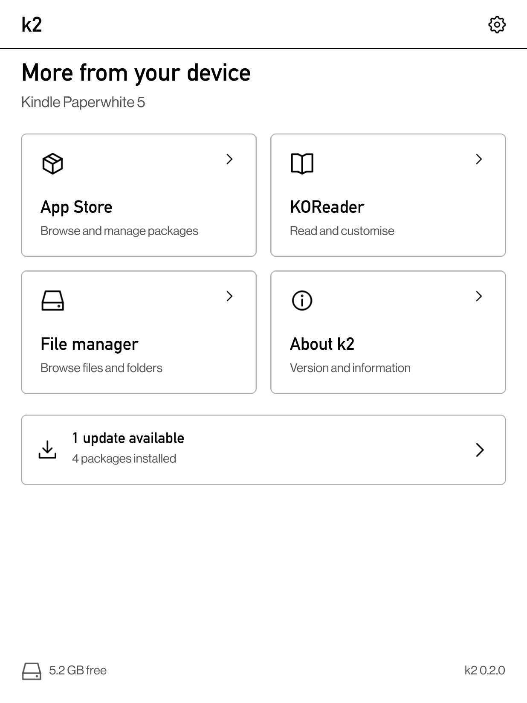
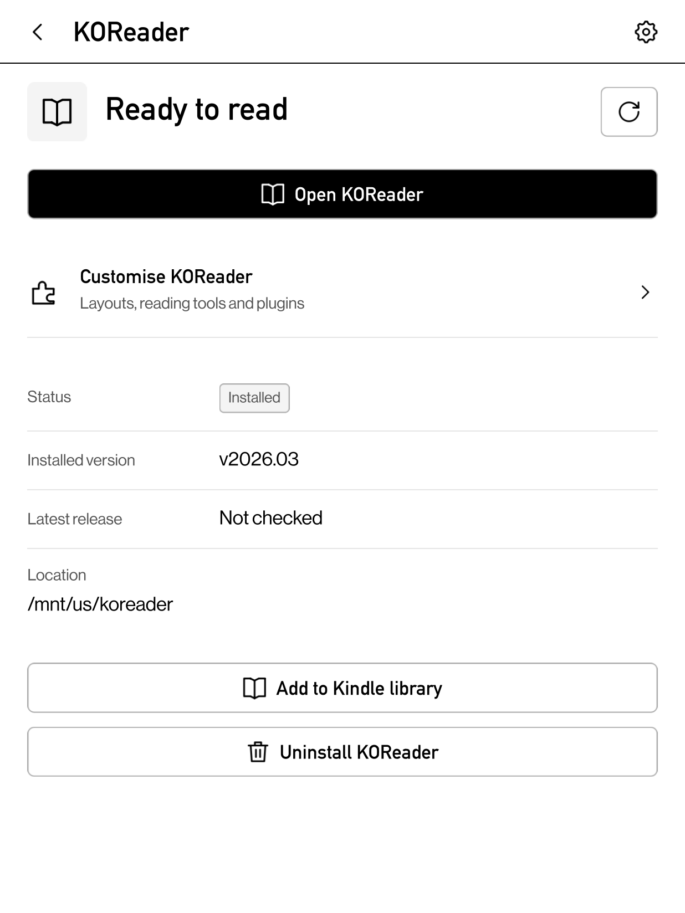
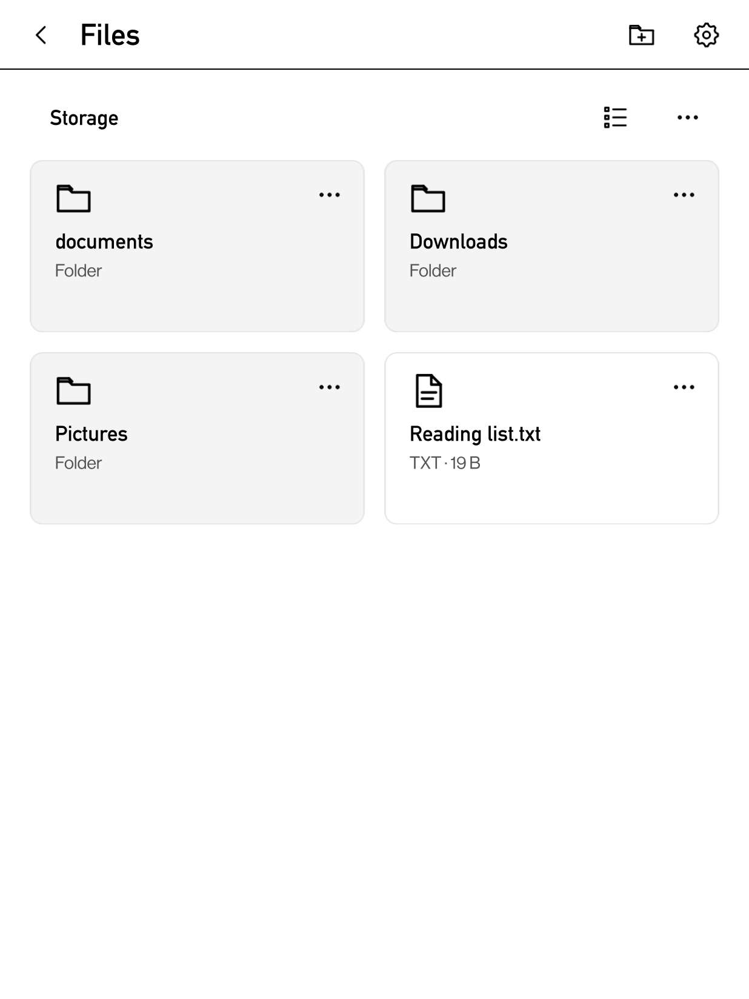

<h1 align="center">K2</h1>

K2 is an app store and device manager for Kindle and Kobo e-readers. Use its
touch interface to install apps, keep packages up to date, set up KOReader,
and organise files on your reader.

<table align="center">
  <tr>
    <td align="center" width="33%">
      
    </td>
    <td align="center" width="33%">
      
    </td>
    <td align="center" width="33%">
      
    </td>
  </tr>
</table>

K2 runs alongside the reader's original software.

## What you can do

- **Find and install software.** Browse featured apps, search the package
  catalogue, and see what is installed. Review dependencies and version changes
  before installing, updating, or removing packages.
- **Manage KOReader.** Install the official stable release, update an existing
  installation, and add plugins and interface customisations. Open KOReader
  directly from K2.
- **Organise your files.** Browse books and folders, switch between grid and list
  views, and create, rename, copy, move, or delete items.
- **Add device tools.** Optional packages provide SSH and USB debugging. On
  supported Kindles, they also provide wireless file transfers and screen
  sharing.

K2 loads the saved package catalogue when you open it and checks the feeds when
a connection is available. You choose which updates to install. Network setup
stays in the reader's original settings.

## Get started

**On a reader:** follow the [installation guide](docs/getting-started.md).
It covers prerequisites, package installation, and how to open K2 on each
platform. Device support depends on the firmware and device profile; the guide
explains how to choose the matching packages.

**On a computer:** use the [desktop simulator](docs/development.md#run-on-a-computer)
to explore the interface or work on K2. It uses sample packages and files, so you
do not need a reader.

## Guides

| I want to… | Read |
| --- | --- |
| Install K2 and open it for the first time | [Getting started](docs/getting-started.md) |
| Install apps, manage files, or change settings | [Using K2](docs/user-guide.md) |
| Set up KOReader and its plugins | [KOReader](docs/koreader.md) |
| Use SSH, file sharing, or screen sharing | [Device tools](docs/device-tools.md) |
| Run, build, or contribute to K2 | [Development](docs/development.md) |
| Try simulator scenarios or control it from a script | [Simulator reference](docs/simulator.md) |
| Add an app shortcut or publish Featured content | [Package and feed integration](docs/integrations.md) |

## Help and contributions

Start with [common problems](docs/user-guide.md#common-problems). For a bug
report, include your device model, firmware, K2 package version, and the steps
that produced the problem. For a failed package operation, include the relevant
output from **Activity → Show details**, after removing any private information.
Use the repository's [issue tracker](https://github.com/katadelos/k2/issues).

K2 is written in Python and Qt Quick. The [development guide](docs/development.md)
explains the code structure, simulator, and required checks for contributions.

## License

K2 is licensed under the [MIT license](LICENSE). Its dependencies and bundled
assets retain their own licenses; see [credits](docs/development.md#credits).
